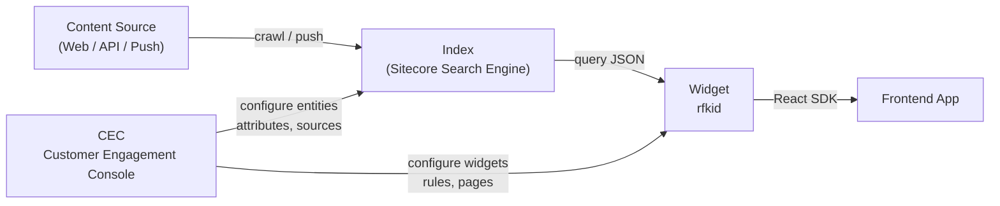
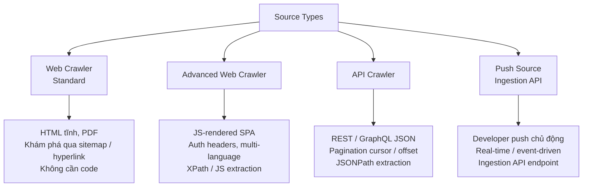
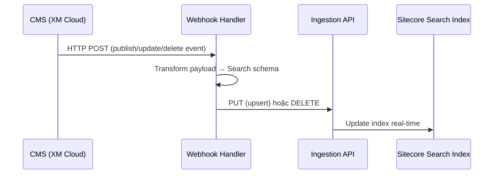
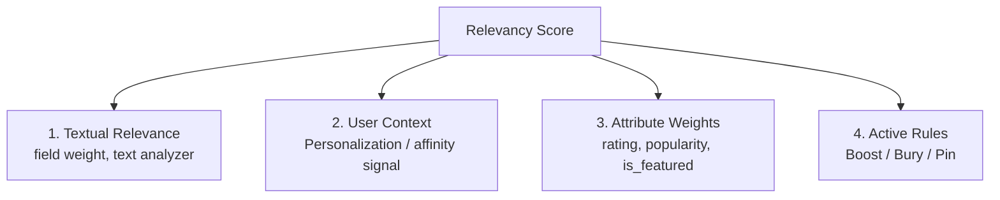

# Sitecore Search — Hướng dẫn tổng quan

> **Nguồn tài liệu:** [Sitecore Search User Guide](https://doc.sitecore.com/search/en/users/search-user-guide/sitecore-search.html)

---

## Mục lục

1. [Tổng quan kiến trúc](#1-tổng-quan-kiến-trúc)
2. [Entity & Attribute](#2-entity--attribute)
3. [Source & Indexing](#3-source--indexing)
4. [Widgets & AI-driven Experiences](#4-widgets--ai-driven-experiences)
5. [Search Ranking & Relevancy](#5-search-ranking--relevancy)
6. [Tích hợp React SDK](#6-tích-hợp-react-sdk)
7. [End-to-End Checklist](#7-end-to-end-checklist)
8. [CEC Quick Reference](#8-cec-quick-reference)

---

## 1. Tổng quan kiến trúc

Sitecore Search là nền tảng **SaaS AI-powered search & discovery**, quản lý qua **Customer Engagement Console (CEC)**. Hoàn toàn headless — trả về JSON qua API, tiêu thụ bởi SDK phía frontend.



### Các khu vực chính trong CEC

| Khu vực | Mục đích |
|---|---|
| **Administration → Domain Settings** | Cấu hình entities, attributes, feature mapping |
| **Sources** | Định nghĩa crawlers và push sources |
| **Content Collection** | Xem & kiểm tra documents đã index |
| **Widgets** | Tạo và cấu hình search/recommendation widgets |
| **Pages** | Map widget vào URL pattern |
| **Developer Resources** | API keys, Domain IDs, API explorer |
| **Analytics** | Hiệu suất, keyphrases, dữ liệu visitor |

### Vai trò người dùng

| Vai trò | Trách nhiệm |
|---|---|
| **TechAdmin** | Cấu hình entities, attributes, sources |
| **Search Developer** | Tích hợp SDK/API, xây dựng frontend |
| **Business User** | Tối ưu keywords, merchandising rules, analytics |

### Phương thức tích hợp frontend

| Phương thức | Dùng khi |
|---|---|
| **Sitecore Cloud SDK** | JSS Next.js / Angular với XM Cloud |
| **JavaScript SDK (React)** | Ứng dụng React |
| **JavaScript Data Package** | Vanilla JS hoặc framework khác |
| **REST APIs** | Custom implementations |

---

## 2. Entity & Attribute

### 2.1 Entity là gì?

**Entity** đại diện cho một loại nội dung có thể search được. Các entity mặc định:

| Entity | Dùng cho |
|---|---|
| `content` | Bài viết, blog posts, tài liệu |
| `product` | Sản phẩm thương mại điện tử |
| `category` | Taxonomy, phân loại |
| `store` | Địa điểm cửa hàng vật lý/ảo |

> [!NOTE]
> Có thể tạo **custom entity** tùy theo nhu cầu (ví dụ: `actor`, `event`, `recipe`). Không thể xóa hoặc sửa attributes kế thừa từ system template — chỉ có thể mở rộng thêm.

### 2.2 Tạo / Chỉnh sửa Entity

1. Đăng nhập **CEC**
2. **Administration → Domain Settings**
3. **General Settings → Entities → Edit**
4. Click **Add Entity** → chọn base template:
   - **Base Attributes Template** (minimal)
   - **Product Template** (có sẵn price, sku, v.v.)
   - **Fully Custom**
5. Đặt tên entity → cấu hình attributes → **Save & Publish**

### 2.3 Attribute — Các kiểu dữ liệu

| Kiểu | Dùng cho | Ví dụ |
|---|---|---|
| **Text / String** | Tên, tiêu đề, mô tả | `title`, `author`, `description` |
| **Number (Int / Decimal)** | Giá, rating, số lượng | `price`, `rating`, `quantity` |
| **Date / Timestamp** | Ngày xuất bản, cập nhật | `publish_date`, `updated_at` |
| **Boolean** | Cờ trạng thái | `is_featured`, `in_stock` |
| **Array of Strings** | Tags, multi-category | `tags`, `category_names` |

### 2.4 Cách tạo Attribute (từng bước)

1. CEC → **Administration → Domain Settings → Attributes**
2. Click **Add Attribute**
3. Điền: tên (lowercase), kiểu dữ liệu
4. Bật **Return in API Response** để attribute xuất hiện trong kết quả
5. Tab **Use For Features** → bật các tính năng cần thiết (xem bảng bên dưới)
6. **Save** → **Reindex** source liên quan

> [!IMPORTANT]
> Sau khi thêm hoặc thay đổi attribute features, bạn **bắt buộc phải reindex** source — thay đổi không có hiệu lực cho đến khi reindex xong.

### 2.5 Attribute Features

| Feature | Mô tả | Ghi chú |
|---|---|---|
| **Textual Relevance** | Đóng góp vào full-text search scoring | Cấu hình trọng số riêng trong Textual Relevance config |
| **Facets** | Bộ lọc đa chiều trên UI | Tự động bật Filters |
| **Filters** | Giới hạn chính xác (hard boundary) | Exact-match hoặc range-based |
| **Sorting** | Cho phép sort kết quả theo field này | Ví dụ: giá tăng/giảm, ngày mới nhất |
| **Search Ranking** | Trọng số ảnh hưởng đến relevancy score | Dùng với `rating`, `popularity` |
| **Personalization** | Cung cấp dữ liệu cho AI affinity model | Dùng với `category`, `brand`, `genre` |

### 2.6 Tuning nâng cao cho Features

| Feature | Tùy chỉnh |
|---|---|
| **Facets** | Max value count, sort order (alpha/frequency), boost/exclude giá trị, histogram intervals |
| **Filters** | Matching logic: exact lowercase, AND vs. OR |
| **Textual Relevance** | Field weight (`title` > `description`), text analyzers |
| **Personalization** | Assign analyzers cho ML model evaluation |

---

## 3. Source & Indexing

### 3.1 Source là gì?

**Source** = cấu hình kết nối tới nơi chứa nội dung, cho Sitecore Search biết:
- **Lấy dữ liệu từ đâu** (URL, API endpoint, sitemap)
- **Cách parse dữ liệu** (CSS/XPath, JSONPath, JavaScript)
- **Map vào attribute nào** của entity

### 3.2 Các loại Source



| Loại | Khi nào dùng |
|---|---|
| **Web Crawler** | Website HTML tĩnh đơn giản, public |
| **Advanced Web Crawler** | SPA/JS rendering, cần auth headers, multi-language |
| **API Crawler** | Headless CMS, REST API có cấu trúc JSON |
| **Push Source** | Real-time sync, event-driven từ webhook CMS |

### 3.3 Cấu hình Source — Web / Advanced Crawler

**Bước 1:** CEC → **Sources → Create Source** → chọn loại crawler

**Bước 2:** Cấu hình **Triggers** (điểm bắt đầu crawl):

```
Sitemap URL:  https://mysite.com/sitemap.xml   ← Ưu tiên dùng
Seed URL:     https://mysite.com/               ← Fallback
```

> [!TIP]
> Ưu tiên dùng **sitemap XML** — crawler tận dụng metadata `<lastmod>` để chỉ crawl lại những trang thay đổi (incremental crawl), tiết kiệm thời gian đáng kể.

**Bước 3:** Cấu hình **Document Extractors** → map raw data vào attributes

#### XPath Extractor (Advanced Web Crawler — HTML)

1. **Sources → [source] → Source Settings → Document Extractors → Edit**
2. Set **Extractor Type = XPath**
3. Thêm **URLs to Match** nếu cần extraction rule riêng theo page pattern
4. Trong **Taggers** → **Add Rule**:
   - Chọn target attribute (ví dụ: `name`, `description`)
   - Nhập XPath expression

Ví dụ XPath mặc định:

| Attribute | XPath |
|---|---|
| `type` | `//meta[@property='og:type']/@content` |
| `url` | `//meta[@property='og:url']/@content` |
| `image_url` | `//meta[@property='og:image']/@content` |
| `name` | `//h1/text()` |
| `description` | `//meta[@name='description']/@content` |

#### JSONPath Extractor (API Crawler — JSON)

Dùng **JSONPath** cho cấu trúc flat/nested đơn giản.
Dùng **JavaScript extractor** cho payload phức tạp cần transform.

```
$.data.title              → name
$.data.body               → description
$.data.featuredImage.url  → image_url
$.data.tags[*]            → tags
$.data.price              → price
```

**Bước 4:** **Save → Publish** → **Run** để index lần đầu

> [!WARNING]
> Luôn click **Publish** sau khi thay đổi cấu hình source/crawler. Thay đổi chỉ có hiệu lực sau khi publish.

### 3.4 Push Source — Real-time Indexing

**Setup trong CEC:**
1. **Content → Search Sources → Create Source → Push Source**
2. Định nghĩa target **Locales** (ví dụ: `en-us`, `vi-vn`)
3. Map tất cả fields (attributes phải được định nghĩa sẵn)
4. Lấy **Source ID**, **Domain ID**, **API Key** từ **Developer Resources → API Access**

**Ingestion API Endpoints:**

```http
# Tạo / Cập nhật document
PUT /ingestion/v1/domains/{domainId}/sources/{sourceId}/entities/{entityId}/documents/{documentId}?locale={locale}
Authorization: ApiKey <your-api-key>
Content-Type: application/json

{
  "document": {
    "id": "product-123",
    "fields": {
      "name": "Áo thun basic",
      "description": "Áo thun cotton 100%",
      "url": "/products/ao-thun-basic",
      "image_url": "https://cdn.mysite.com/ao-thun.jpg",
      "price": 199000
    }
  }
}

# Xóa document
DELETE /ingestion/v1/domains/{domainId}/sources/{sourceId}/entities/{entityId}/documents/{documentId}?locale={locale}
```

### 3.5 Webhook — Real-Time Sync từ CMS

**Luồng hoạt động:**



**Ghi chú quan trọng:**
- `PUT` = upsert (tạo mới hoặc cập nhật)
- `DELETE` = xóa document khỏi index
- Webhook tự động bị vô hiệu hóa sau **10 lần thất bại liên tiếp**
- Handler có thể là: Azure Function, AWS Lambda, Next.js API route

### 3.6 Quản lý Index

| Action | CEC Path |
|---|---|
| Xem documents đã index | **Content Collection** |
| Xem logs crawl/parse | **Sources → [source] → Logs** |
| Reindex toàn bộ | **Sources → [source] → Reindex** |
| Incremental crawl | **Sources → [source] → Run incremental** |

---

## 4. Widgets & AI-driven Experiences

### 4.1 Các khái niệm cốt lõi

| Khái niệm | Định nghĩa |
|---|---|
| **Widget** | Cấu hình headless của trải nghiệm search; trả về JSON qua API |
| **Page** | Container nhóm các widget, map tới URL hoặc URL pattern |
| **Widget Variation** | Phiên bản cấu hình trong widget; chỉ 1 variation active tại 1 thời điểm |
| **Rule** | Business logic áp dụng trong variation (boost, bury, pin) |

### 4.2 Các loại Widget

| Widget | Mục đích | Default RFK ID |
|---|---|---|
| **Preview Search** | Typeahead / instant suggestions khi gõ | `rfkid_6` |
| **Search Results** | Trang kết quả đầy đủ với facet, sort, pagination | — |
| **Recommendation** | Gợi ý AI/ML cá nhân hóa | — |

**Preview Search** — hiển thị real-time results khi user gõ, keyword suggestions, auto-correct, active mặc định trên **All Pages**.

**Search Results** — hỗ trợ: document grouping, facet management, sorting, filtering, merchandising rules.

**Recommendation** — các AI recipe: *Frequently Bought Together*, *More Like This*, *Trending Products*, *Top Viewed*. Fallback về popular items cho anonymous visitors.

### 4.3 Tạo Widget trong CEC (từng bước)

1. CEC → **Widgets → Add Widget**
2. Chọn widget type: *Search Results*, *Preview Search*, hoặc *Recommendation*
3. Điền thông tin:

| Trường | Ví dụ |
|---|---|
| **Widget Name** | `Header Preview Search` |
| **RFK ID** | `rfkid_6` (tự sinh hoặc tự nhập) |
| **Variation Name** | `Default` |

4. Với **Recommendation**: chọn **Recipe** (AI algorithm)
5. **Next → Save → Publish**

> [!IMPORTANT]
> Sau khi publish widget, copy `rfkid` để dùng trong code React frontend. `rfkid` là cầu nối duy nhất giữa CEC config và frontend code.

### 4.4 Widget Variations & Rules

**Variations:**
- Chỉ **1 variation active** tại một thời điểm
- Hỗ trợ nhiều variations cho A/B testing hoặc scheduling
- **Global Widget** = base settings; individual widget variations override với precedence cao nhất

**Rule Types:**

| Rule | Hiệu ứng |
|---|---|
| **Boost** | Tăng relevance score của items thỏa điều kiện |
| **Bury** | Giảm score, đẩy items xuống dưới |
| **Pin** | Cố định item ở vị trí tuyệt đối, bypass relevance |

**Cách tạo Rule:**
1. **Widgets → [widget] → Widget Variations → [variation] → Add Rule**
2. Định nghĩa **Context** (điều kiện trigger: keywords, user segment, geolocation, date/time)
3. Chọn **Output Entity** (áp dụng cho entity nào)
4. Chọn **Strategy** (Boost / Bury / Pin)
5. **Save → Publish**

> [!NOTE]
> Rules ở vị trí **cao hơn trong danh sách** được thực thi trước và override rules phía dưới.

### 4.5 Page Types

| Page Type | Mô tả |
|---|---|
| **Product Details Page (PDP)** | Gợi ý cá nhân hóa, similar items, trending alternatives |
| **Product Listing Page (PLP)** | Category-bound pages với sorted lists + recommendation widgets |
| **Landing / Promotional Page** | Multi-category custom pages với hard filters |

### 4.6 Personalization — Setup từng bước

**Bước 1 — Bật attribute:**
1. **Administration → Domain Settings → Attributes**
2. Chọn attribute (ví dụ: `category`, `brand`, `genre`)
3. Tích **Personalization** trong *Use For Features* → **Apply → Save**

**Bước 2 — Cấu hình analyzers:**
1. **Administration → Domain Settings → Feature Configuration → Personalization**
2. Gán **Analyzer** phù hợp cho từng personalization attribute

**Bước 3 — Tạo Recommendation Widget** (chọn recipe phù hợp)

**Bước 4 — Gán widget vào Page** trong CEC trước khi implement frontend

**Cơ chế Personalization:**
- **Affinity Scoring**: Xây dựng preference profile từ lịch sử tương tác của visitor
- **More Like This**: Surface items tương tự với nội dung đang xem

---

## 5. Search Ranking & Relevancy

### 5.1 Các thành phần tạo nên Relevancy Score



### 5.2 Precedence của Ranking

```
Pin rules          → override TẤT CẢ ranking (vị trí tuyệt đối)
    ↓
Boost / Bury rules → điều chỉnh relevancy score
    ↓
Textual relevance + attribute weights → base score
    ↓
Personalization signals → modifier layer
```

### 5.3 Cấu hình Search Ranking

**Bước 1 — Bật attribute cho ranking:**
1. **Domain Settings → Attributes → [attribute]**
2. Tích **Search Ranking** → Save → Reindex

**Bước 2 — Gán trọng số:**
1. **Global Resources → Global Widget → Search Ranking**
2. Gán numeric weight cho từng attribute (bắt đầu với `1.0`, tune dần)

> [!TIP]
> Chỉ nên dùng **0-5 attributes** cho search ranking. Quá nhiều attribute sẽ làm loãng relevancy score của AI.

### 5.4 Textual Relevance Configuration

1. Widget config → **Textual Relevance → Advanced Mode**
2. Gán field weight rõ ràng: `title` > `description` > `body`
3. Cấu hình text analyzers per field

---

## 6. Tích hợp React SDK

### 6.1 Cài đặt

```bash
npm install @sitecore-search/react @sitecore-search/ui @sitecore-search/data
```

### 6.2 Environment Variables

```env
NEXT_PUBLIC_SITECORE_SEARCH_ENV=apse2
NEXT_PUBLIC_SITECORE_SEARCH_CUSTOMER_KEY=83942041-179199281
NEXT_PUBLIC_SITECORE_SEARCH_API_KEY=01-77cd26d5-...
NEXT_PUBLIC_SITECORE_SEARCH_SERVICE_HOST=https://api-apse2.rfksrv.com
```

### 6.3 WidgetsProvider — Bao toàn app

```tsx
// src/providers/SitecoreSearchProvider.tsx
'use client';

import { WidgetsProvider } from '@sitecore-search/react';

export function SitecoreSearchProvider({ children }: { children: React.ReactNode }) {
  return (
    <WidgetsProvider
      env={process.env.NEXT_PUBLIC_SITECORE_SEARCH_ENV}
      customerKey={process.env.NEXT_PUBLIC_SITECORE_SEARCH_CUSTOMER_KEY}
      apiKey={process.env.NEXT_PUBLIC_SITECORE_SEARCH_API_KEY}
      serviceHost={process.env.NEXT_PUBLIC_SITECORE_SEARCH_SERVICE_HOST}
    >
      {children}
    </WidgetsProvider>
  );
}
```

> [!IMPORTANT]
> Trong **Next.js App Router**, phải thêm `'use client'` và render `WidgetsProvider` ở client side. Không dùng trong Server Components. Nếu cần, dùng dynamic import với `ssr: false`.

### 6.4 Preview Search Widget

```tsx
// src/components/SitecorePreviewSearch/SitecorePreviewSearch.tsx
'use client';

import { usePreviewSearch, widget } from '@sitecore-search/react';
import { WidgetDataType } from '@sitecore-search/data';
import type { PreviewSearchInitialState } from '@sitecore-search/react';

const PREVIEW_RFK_ID = 'rfkid_6'; // phải khớp với rfkid trong CEC

function PreviewSearchComponent() {
  const {
    actions: { onKeyphraseChange },
    queryResult,
  } = usePreviewSearch<unknown, PreviewSearchInitialState<'itemsPerPage'>>({
    state: { itemsPerPage: 4 },
  });

  const results = queryResult.data?.content ?? [];
  const isLoading = queryResult.isLoading || queryResult.isFetching;

  return (
    <div className="preview-search">
      <input
        type="search"
        placeholder="Tìm kiếm..."
        onChange={(e) => onKeyphraseChange({ keyphrase: e.target.value })}
      />
      {isLoading && <p>Đang tải...</p>}
      <div className="suggestions">
        {results.map((item: any) => (
          <a key={item.id} href={item.url}>
            {item.image_url && }
            <span>{item.name}</span>
          </a>
        ))}
      </div>
    </div>
  );
}

// Wrap với widget() HOC để bind vào Sitecore Search engine
export const PreviewSearch = widget(
  PreviewSearchComponent,
  WidgetDataType.PREVIEW_SEARCH,
  'content'
);

// Dùng trong layout/header:
// <PreviewSearch rfkId={PREVIEW_RFK_ID} />
```

### 6.5 Search Results Widget

```tsx
// src/components/search/SitecoreSearchResults.tsx
'use client';

import { useSearchResults, widget } from '@sitecore-search/react';
import { WidgetDataType } from '@sitecore-search/data';

function SearchResultsComponent() {
  const {
    actions: { onFacetClick, onSortChange, onPageNumberChange, onClearFilters },
    state: { page, sortType },
    queryResult,
  } = useSearchResults({
    state: {
      itemsPerPage: 12,
      sortType: 'featured_desc',
    },
  });

  const { data, isLoading } = queryResult;
  const results = data?.content ?? [];
  const facets  = data?.facet   ?? [];
  const total   = data?.total_item ?? 0;
  const totalPages = Math.ceil(total / 12);

  return (
    <div className="search-layout">
      {/* Sidebar Facets */}
      <aside>
        <button onClick={() => onClearFilters({})}>Xóa bộ lọc</button>
        {facets.map((facet: any) => (
          <div key={facet.name}>
            <h3>{facet.label}</h3>
            {facet.value.map((val: any) => (
              <label key={val.id}>
                <input
                  type="checkbox"
                  onChange={() =>
                    onFacetClick({ facetId: facet.name, facetValueId: val.id, checked: true })
                  }
                />
                {val.text} ({val.count})
              </label>
            ))}
          </div>
        ))}
      </aside>

      {/* Results Grid */}
      <main>
        <div className="sort-bar">
          <span>Tìm thấy {total} kết quả</span>
          <select onChange={(e) => onSortChange({ sortType: e.target.value })}>
            <option value="featured_desc">Nổi bật</option>
            <option value="price_asc">Giá thấp → cao</option>
            <option value="date_desc">Mới nhất</option>
          </select>
        </div>

        {isLoading ? (
          <p>Đang tải...</p>
        ) : (
          <div className="results-grid">
            {results.map((item: any) => (
              <div key={item.id} className="result-card">
                
                <h2>{item.name}</h2>
                <p>{item.description}</p>
                <a href={item.url}>Xem chi tiết</a>
              </div>
            ))}
          </div>
        )}

        {/* Pagination */}
        <div className="pagination">
          {Array.from({ length: totalPages }, (_, i) => i + 1).map((p) => (
            <button
              key={p}
              onClick={() => onPageNumberChange({ page: p })}
              disabled={p === page}
            >
              {p}
            </button>
          ))}
        </div>
      </main>
    </div>
  );
}

export const SearchResults = widget(
  SearchResultsComponent,
  WidgetDataType.SEARCH_RESULTS,
  'content'
);

// Dùng trên trang /search:
// <SearchResults rfkId="rfkid_sdk_search" defaultKeyphrase={searchParams.q} />
```

### 6.6 Recommendation Widget

```tsx
'use client';

import { useRecommendation, widget } from '@sitecore-search/react';
import { WidgetDataType } from '@sitecore-search/data';

function RecommendationComponent() {
  const { queryResult } = useRecommendation({ state: { itemsPerPage: 6 } });
  const items = queryResult.data?.content ?? [];

  return (
    <div className="recommendations">
      <h2>Có thể bạn thích</h2>
      <div className="rec-grid">
        {items.map((item: any) => (
          <a key={item.id} href={item.url} className="rec-card">
            
            <span>{item.name}</span>
          </a>
        ))}
      </div>
    </div>
  );
}

export const ProductRecommendation = widget(
  RecommendationComponent,
  WidgetDataType.RECOMMENDATION,
  'product'
);

// Dùng trên PDP:
// <ProductRecommendation rfkId="rfkid_trending" />
```

### 6.7 Tổng hợp Hooks

| Hook | Widget type | Mô tả |
|---|---|---|
| `usePreviewSearch` | Preview Search | Instant suggestions khi gõ |
| `useSearchResults` | Search Results | Full search với facet, sort, pagination |
| `useRecommendation` | Recommendation | Gợi ý AI cá nhân hóa |
| `useSearchResultsSelectedFilters` | Search Results | Quản lý filter đang được chọn |

> [!TIP]
> **Event Tracking tự động:** SDK React tự động dispatch events (click, search, pagination) về Sitecore cho analytics và ML optimization. Không viết custom click handler bypass SDK action dispatchers.

---

## 7. End-to-End Checklist

### Phase 1: CEC Setup
- [ ] Đăng nhập CEC qua Sitecore Cloud Portal invitation
- [ ] Review / tạo entities (Content, Product, Category, Store, Custom)
- [ ] Định nghĩa tất cả attributes cần thiết, chọn đúng kiểu dữ liệu
- [ ] Bật attribute features: Search, Facets, Filters, Sorting, Ranking, Personalization
- [ ] Cấu hình analyzers và weights trong Feature Configuration

### Phase 2: Content Indexing
- [ ] Chọn loại source: Web Crawler / Advanced / API Crawler / Push Source
- [ ] Cấu hình triggers (sitemap URL / seed URL / API endpoint)
- [ ] Xây dựng document extractors (XPath cho HTML, JSONPath/JS cho API)
- [ ] Map source attributes → domain attribute schema
- [ ] **Publish** cấu hình source
- [ ] Run lần đầu → kiểm tra Documents trong **Content Collection**

### Phase 3: Real-Time Updates (nếu cần)
- [ ] Tạo Push Source trong CEC
- [ ] Lấy Source ID, Domain ID, API Key từ Developer Resources
- [ ] Implement webhook receiver middleware
- [ ] Handle `PUT` (create/update) và `DELETE` events → Ingestion API

### Phase 4: Widgets & Search Experiences
- [ ] Tạo **Preview Search widget** → lấy `rfkid`
- [ ] Tạo **Search Results widget** → lấy `rfkid`
- [ ] Tạo **Recommendation widgets** với AI recipes phù hợp
- [ ] Cấu hình widget variations và set active variation
- [ ] Thêm boost/bury/pin rules (nếu cần)
- [ ] Gán widgets vào Pages (URL patterns)
- [ ] Cấu hình Textual Relevance và Ranking weights
- [ ] **Publish** tất cả configurations

### Phase 5: Frontend Integration
- [ ] Lấy API Key và Domain ID từ Developer Resources
- [ ] Thêm env variables vào `.env` / Vercel dashboard
- [ ] Wrap app với `WidgetsProvider`
- [ ] Implement `usePreviewSearch` cho header search bar
- [ ] Implement `useSearchResults` cho trang `/search`
- [ ] Implement `useRecommendation` cho PDP / PLP
- [ ] Instrument event tracking (click, search, conversion)

### Phase 6: Optimization
- [ ] Monitor **Analytics** dashboard trong CEC
- [ ] Tune Textual Relevance field weights
- [ ] Điều chỉnh Search Ranking attribute weights
- [ ] Thêm / tinh chỉnh merchandising rules
- [ ] Mở rộng Personalization attributes dựa trên visitor behavior data
- [ ] Cân nhắc A/B Testing với widget variations

---

## 8. CEC Quick Reference

| Task | CEC Path |
|---|---|
| Thêm / chỉnh sửa entity | **Administration → Domain Settings → General Settings → Entities → Edit** |
| Thêm attribute | **Administration → Domain Settings → Attributes → Add Attribute** |
| Bật attribute features | **Administration → Domain Settings → Attributes → [attribute] → Use For Features** |
| Cấu hình analyzers | **Administration → Domain Settings → Feature Configuration** |
| Tạo crawler source | **Sources → Create Source** |
| Xem documents đã index | **Content Collection** |
| Lấy API keys | **Developer Resources → API Access** |
| Tạo widget | **Widgets → Add Widget** |
| Cấu hình widget rules | **Widgets → [widget] → Widget Variations → [variation] → Add Rule** |
| Gán widget vào page | **Pages → [page] → Add Widget** |
| Monitor analytics | **Analytics** |

---

> **Tài liệu chính thức:**
> - [Configure entities](https://doc.sitecore.com/search/en/users/search-user-guide/configure-entities.html)
> - [Index items](https://doc.sitecore.com/search/en/users/search-user-guide/index-items.html)
> - [AI-driven experiences](https://doc.sitecore.com/search/en/users/search-user-guide/ai-driven-experiences.html)
> - [Get started](https://doc.sitecore.com/search/en/users/search-user-guide/get-started.html)
> - [Search User Guide](https://doc.sitecore.com/search/en/users/search-user-guide/sitecore-search.html)
